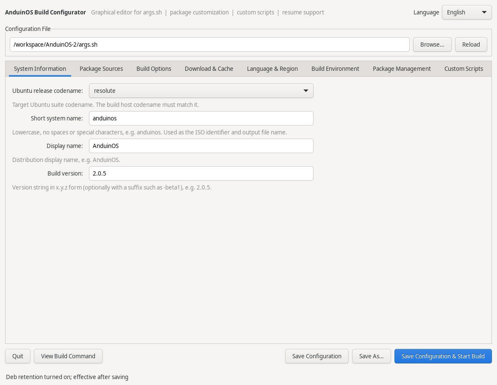
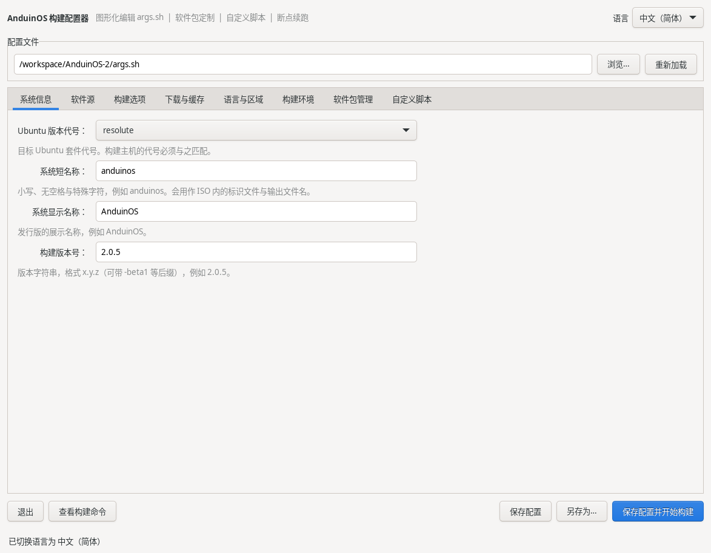
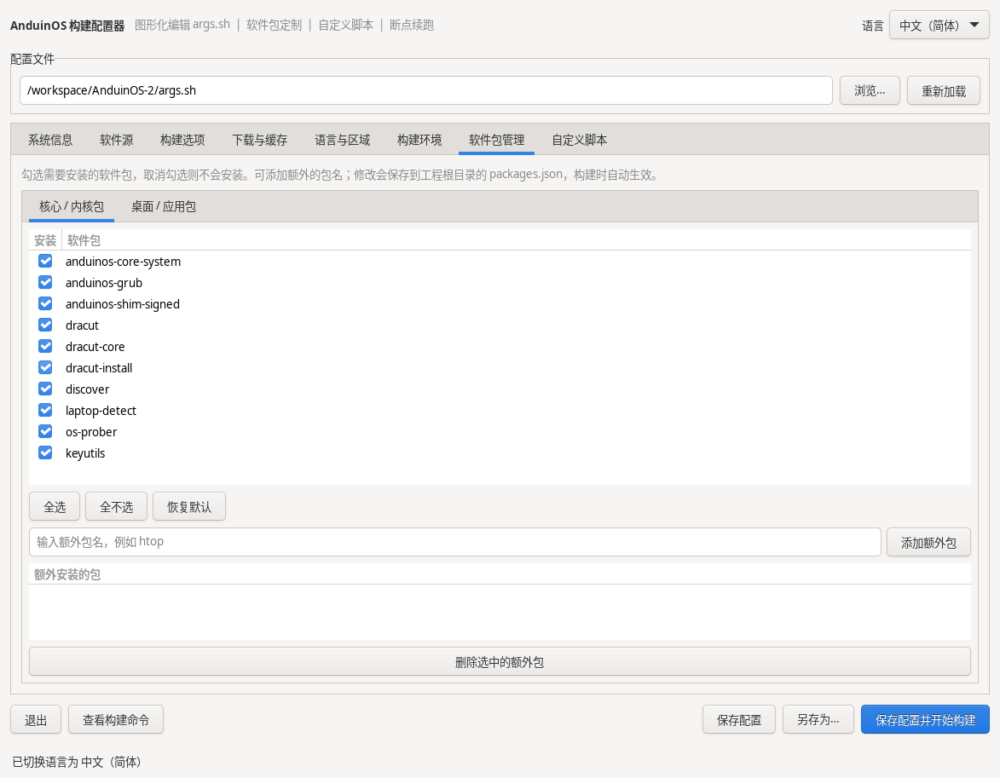
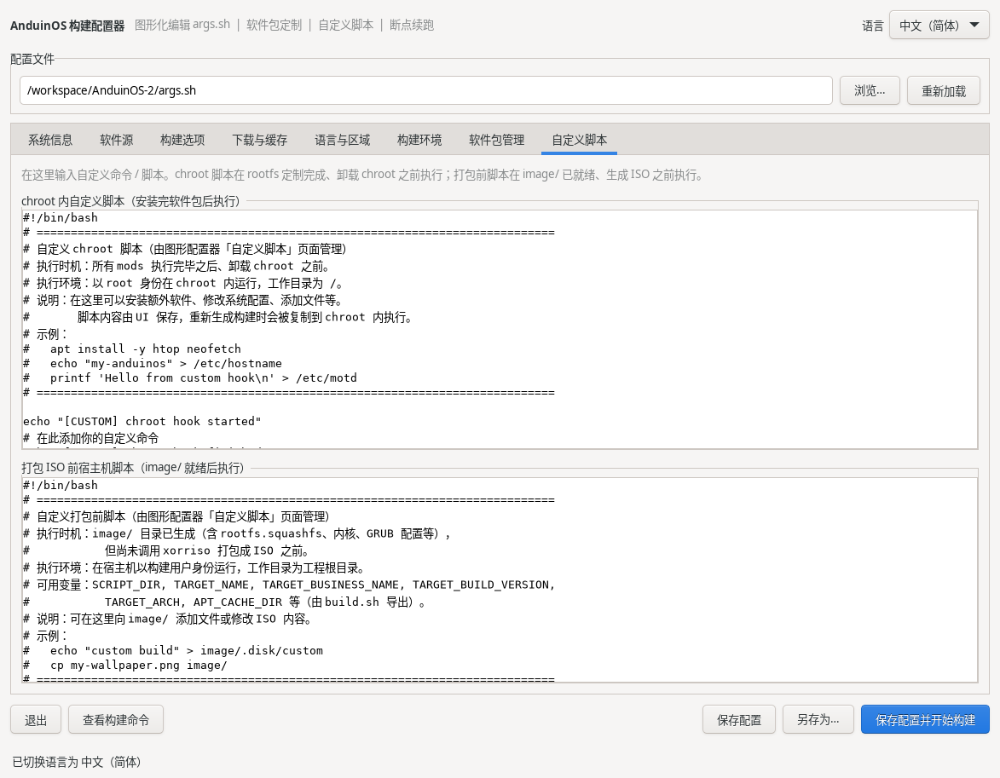

# AnduinOS 构建配置器（GTK3 图形界面）

为 [AnduinOS-2](../README.md) 编写的 GTK3 图形配置工具（PyGObject），替代手写 `args.sh` 变量和 `whiptail` 文本菜单。覆盖全部构建参数，并新增：

- **保留已下载的 .deb 包**开关（网络不稳定时重试免于重复下载）
- **软件包管理**：勾选安装哪些包 / 不安装哪些包，可添加额外包
- **自定义脚本**：chroot 内 hook、打包 ISO 前宿主机 hook
- **保存配置并开始构建**，脚本中途失败可**从中断处继续**
- **i18n 多语言**：默认英文，中文以明文 JSON 存储，顶部下拉框随时切换；新增翻译文件会被自动发现









## 1. 运行方式

### 方式 A：源码直接运行

```bash
cd /path/to/AnduinOS-2
make gui
# 或
python3 gui/anduinos_config_ui.py --args ./args.sh
```

依赖：`python3`、`python3-gi`、`gir1.2-gtk-3.0`（Ubuntu：`sudo apt install python3-gi gir1.2-gtk-3.0`）。

### 方式 B：安装 .deb 包

```bash
sudo dpkg -i dist/anduinos-config-ui_2.0.0_all.deb
anduinos-config-ui
anduinos-config-ui --args /path/to/AnduinOS-2/args.sh
```

安装后出现在「系统/设置」菜单（AnduinOS Build Configurator）。

### 方式 C：源码包

```bash
tar -xzf AnduinOS-2-source.tar.gz
cd AnduinOS-2 && make gui
```

## 2. 界面功能

共 8 个标签页：

| 标签页 | 内容 |
| --- | --- |
| 系统信息 | Ubuntu 版本代号、系统短名称、显示名称、构建版本号 |
| 软件源 | Ubuntu APT 镜像、AnduinOS 包服务器、签名证书名、APT 配置包 |
| 构建选项 | 目标架构、保留已下载的 .deb 包 |
| 下载与缓存 | deb 保留开关、缓存目录/数量/大小、刷新 / 打开 / 清空 |
| 语言与区域 | 语言包代码、Live 区域策略（29 条校验提醒） |
| 构建环境 | DEBIAN_FRONTEND、LC_ALL、LANG、LANGUAGE |
| 软件包管理 | 核心包 / 桌面包勾选列表、全选/全不选/恢复默认、添加/删除额外包 |
| 自定义脚本 | chroot 内脚本、打包 ISO 前宿主机脚本（Tab 式多页代码编辑） |

底部按钮：

- **保存配置**：原地保存 `args.sh`（自动备份 `.bak`），同时保存 `packages.json` 与两个 hook 脚本
- **另存为…**：弹出 GTK 文件选择对话框，把全部配置写入新工程目录
- **保存配置并开始构建**：保存后选择「全新构建」或「从中断处继续」，打开实时构建日志窗口
- **查看构建命令**、**退出**

窗口右上角有 **Language / 语言** 下拉框，切换后所有标签页、按钮、帮助文本、提示对话框与构建日志窗口的文字会立即刷新，无需重启。

## 3. 各项功能如何生效

### 3.1 deb 包保留

`args.sh` 中的 `KEEP_DOWNLOADED_DEBS="true"` 控制。构建时 `build.sh` 把宿主机 `.cache/apt-archives/` bind-mount 到 chroot 的 `/var/cache/apt/archives`，`clean()` 不再删除该目录；`mods/85-cleanup-mod` 在开关开启时跳过缓存清理。SquashFS 导出原本就排除该路径，因此**不影响 ISO 体积**。

### 3.2 软件包勾选

配置保存在工程根目录 `packages.json`：

```json
{
  "version": 1,
  "core": { "anduinos-core-system": true, ... },
  "desktop": { "anduinos-desktop": true, ... },
  "extra_core": [],
  "extra_desktop": []
}
```

构建时 `build.sh` 调用 `gui/packages_config.py --generate` 生成 `.cache/build/core_packages.txt` 和 `desktop_packages.txt`，复制到 chroot 的 `/root/mods/`；`mods/05-live-kernel-apps-installer/install.sh` 用 `mapfile` 读取列表后执行 `apt install`。取消勾选的包不会安装，额外包会被加入。

### 3.3 自定义脚本

| 文件 | 执行时机 | 环境 |
| --- | --- | --- |
| `custom_hooks.sh` | 所有 mods 完成后、卸载 chroot 前 | chroot 内、root、工作目录 `/` |
| `custom_pre_iso.sh` | `image/` 已就绪、xorriso 打包前 | 宿主机、构建用户、工作目录为工程根目录 |

脚本内容由 UI 直接读写，构建时若文件非空则自动执行。可用变量：`SCRIPT_DIR`、`TARGET_NAME`、`TARGET_BUSINESS_NAME`、`TARGET_BUILD_VERSION`、`TARGET_ARCH`、`APT_CACHE_DIR`。

### 3.4 断点续跑

构建被划分为 7 个阶段，每阶段成功写入 `.cache/build-state/<阶段>.ok`：

```
prepare → mount_apt → mods → custom_chroot → export → efi → iso
```

中途失败后：

- 在构建日志窗口点击「从中断处继续」，或
- 执行 `make resume` / `./build.sh --resume`

已完成的阶段会被跳过。若上次进程退出导致 chroot 挂载丢失，脚本会自动重新执行挂载及其后阶段。

### 3.5 多语言（i18n）

默认界面语言为 **英文**。所有界面文本都通过 `gui/i18n.py` 的词条键获取，内置英文兜底字典保证即使语言文件缺失也不会出现空白。

语言文件位于 `gui/locales/`，是普通 UTF-8 明文 JSON（中文按真实汉字写入，不编译为二进制）：

| 文件 | 说明 |
| --- | --- |
| `en.json` | 英文词条（可覆盖内置默认） |
| `zh_CN.json` | 简体中文词条 |

文件结构：

```json
{
  "_meta": {
    "code": "zh_CN",
    "name": "Chinese (Simplified)",
    "native": "中文（简体）"
  },
  "strings": {
    "app.title": "AnduinOS 构建配置器",
    "...": "..."
  }
}
```

**新增语言**：把 `en.json` 复制为 `locales/<语言代码>.json`（例如 `ja.json`），修改 `_meta` 并翻译 `strings` 中的值即可。程序启动时自动扫描 `locales/*.json`，新语言会自动出现在下拉框中，无需改动代码。`_meta.native` 是下拉框显示名，建议用该语言自身书写。`strings` 中缺失的键会回退到英文。词条支持 `%(name)s` 命名占位符（如 `cache.count`）。

语言选择是会话级的，重启后默认回到英文；它只影响界面显示，不写入 `args.sh`，也不会改变构建配置。

## 4. 重新打包

```bash
./gui/build_deb.sh          # dist/anduinos-config-ui_2.0.0_all.deb（含 i18n.py 与 locales/）
```

源码包在工程根目录的上级生成：

```bash
cd /workspace && tar -czf AnduinOS-2-source.tar.gz --exclude=AnduinOS-2/dist --exclude=AnduinOS-2/build AnduinOS-2
```

## 5. 验证记录

- GTK3 UI 冒烟测试（Xvfb）：8 页、16 个配置控件、软件包列表、hook 加载、完整保存流程、包过滤均通过
- 断点续跑测试：阶段标记写入、RESUME 模式跳过已完成阶段正常
- 脚本语法检查：build.sh、mods/05、打包脚本均通过 `bash -n`
- deb 包结构与元数据正确（Architecture: all，依赖 python3-gi / gir1.2-gtk-3.0）
- i18n 测试（Xvfb）：默认英文、中英实时切换、自动发现新增 `fr.json`、词条缺失回退英文、切换后保存流程不受影响，均通过

## 6. 注意事项

- 构建 ISO 仍需满足原工程要求：普通用户 + sudo、主机代号与 `TARGET_UBUNTU_VERSION` 一致、已安装 `make bootstrap` 依赖。
- 本工具只修改构建配置并启动构建，不会在宿主机安装生成的 ISO。
- 构建日志窗口的「停止」会向进程组发送 SIGTERM；未完成阶段不会写入标记，可直接续跑。
